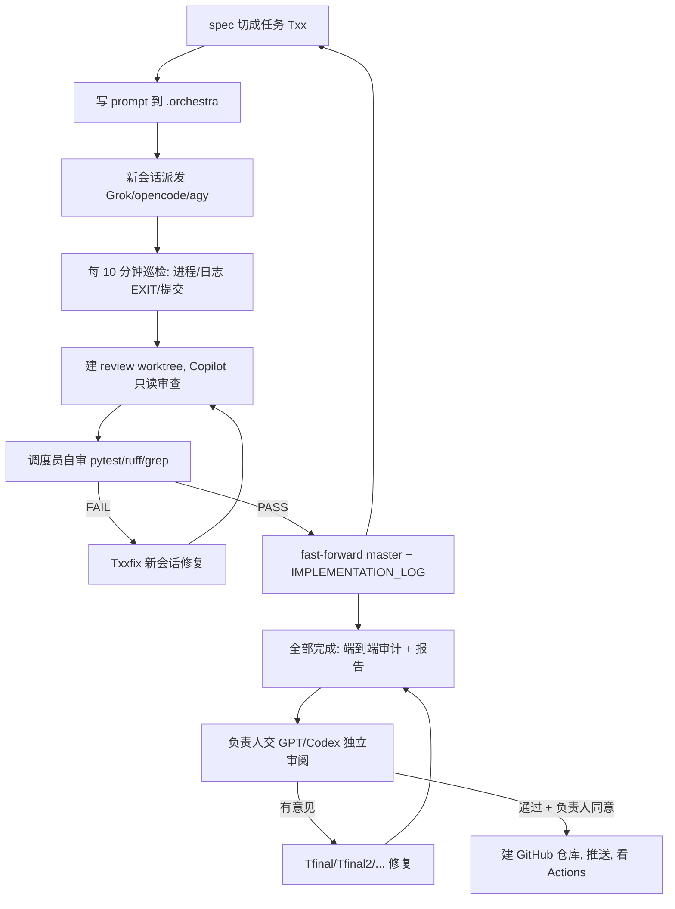

# 多 Agent 协作开发项目：逐步操作手册（Silicon CSI 实战版）

**版本：v2.0 ｜ 编写日期：2026-10-27 ｜ 语言：中文**
**来源：** Silicon CSI 项目（2026-10-23 至 10-27）实际跑过的命令、prompt、日志和报告，都取自 `C:\Users\Du200\Projects\silicon-csi\.orchestra\`。凡是标了 **【未核实】** 的地方，表示在现有文件里没找到原始记录，用前要自己确认。

> 本手册分两部分：
> - **A 部分**：经验总结（v1 原文，全部保留）；
> - **B 部分**：可以照着一步步做的操作教程，包括环境、启动命令、prompt 模板、巡检、审查、合并、报告模板、时间线和补充教训。

## 0. 先读这一节

### 0.1 五条硬规则

1. **调度员不写项目代码。** 调度员只做切分、写 prompt、派发、巡检、审查、合并、写报告。源码、测试和文档都交给 agent 写。
2. **每个任务开全新会话**，prompt 要短、自包含。修复任务也开新会话。
3. **每个任务两道审查**：Copilot 只读审查和调度员自审，两道都过了才能合并。
4. **只写朴素代码**：spec 没要求的机制（哈希、签名、额外抽象、安全加固）一律不加。真值隔离做到 spec 要求的程度就够了。
5. **不碰负责人自己的进程**（codex、agy、opencode-serve、空闲的 grok）。需要负责人决定的事用中文问，一个问题只问一次。TEST 集、推送 GitHub、建仓库都要负责人点头。

### 0.2 整体循环



---

# A 部分：经验总结（v1 原文）

## A1. 角色分工

| 角色 | 谁 | 职责 |
|---|---|---|
| 负责人 | Cd | 定 spec、做决策、最终验收（交给 GPT/Codex 独立审阅） |
| 调度员 | silicon control（我） | 切分任务、写 prompt、派发、整合、第二道审查、写报告；**不写项目代码** |
| 主力编码 | Grok Build 4.7 high | 新任务的实现 |
| 修复批次 | opencode（免费模型） | 小修复、收尾的杂项 |
| 审查 | Copilot 默认免费模型 | 只读审查，写 `REVIEW_*.md` |
| 文档 | agy (Antigravity) | 文档类任务 |

经验：
- 调度者坚持不写代码，职责才清楚，出了问题也知道是哪个 agent 的。
- 角色要能随时换。中途 Codex 额度用完了，主力改成 opencode；后来 Grok 加入，又改成 Grok 主力。每次换角色都要记下来。
- 只用免费或已付费的工具。Copilot 一旦提示额度用完或要收费，就先停下来问负责人。

## A2. 目录与分支

- 主仓库：`C:\Users\Du200\Projects\<project>`，`master` 分支只接收审过的提交。
- 构建 worktree：`C:\Users\Du200\Projects\<project>-codex`（`codex` 分支），所有 agent 都在这里写代码。
- 审查 worktree：`.orchestra\review_<任务>`。每次审查新建一个，审完要清理（这轮最后积了约 31 个没删）。
- 调度文件统一放在 `.orchestra\`：
  - `<任务>_<agent>_prompt.md`
  - `<任务>_<agent>.log`
  - `<任务>_report.md`
  - `REVIEW_<任务>.md`
- 合并方式：审查通过后把 `codex` fast-forward 到 `master`。

## A3. 单个任务的流程

1. **切分**：按 spec 切成小任务（T01…T24），每个任务写清楚通过标准和需要提交的证据。
2. **写 prompt**：短小、自包含，只指向相关的 spec 章节、报告和文件路径。
3. **派发**：每个任务都开**全新会话**，不续用旧会话，控制上下文大小。
   - Grok：用 Windows 计划任务启动，stdin 接 NUL。日志最后一行写 `EXIT <code>`，方便判断是否结束。
   - agy：`agy.exe --model gemini-3.8-flash-high --dangerously-skip-permissions -p <prompt>`，详见 B2.3
   - Grok（实际命令）：`grok.exe -m grok-4.7 --reasoning-effort high --always-approve --prompt-file <prompt.md>`，详见 B2.1
4. **巡检**：大约每 10 分钟看一次进度，包括进程、日志、worktree 改动和提交，别让做完的 agent 空等。超过约 30 分钟既没改动也没日志，就当作可能卡住，去检查。
5. **双重审查**（两道都过了才派下一阶段）：
   - Copilot 只读审查。
   - 我自己审查，内容包括：
     - 跑 `pytest` 和 `ruff`；
     - 对照通过标准和 spec 要求的证据；
     - 查真值隔离有没有泄漏；
     - 查有没有硬编码答案、编造的数字、空测试。
6. **失败处理**：根据审查意见开一个修复批次（例如 `T24fix`），修完再走一遍双重审查。
7. **合并并记录**：合并到 master，更新 `IMPLEMENTATION_LOG`，记下提交号。

## A4. 踩过的坑

- **编造数据**：T24 的 demo 脚本里写死了探针、排名、运行时间和真值，GIF 也是手画的。规则：所有展示的数字和图都必须来自真实运行。审查时要专门查有没有硬编码数字。
- **答案泄漏**：T23 的 case ID 里带了 seed，还缺可识别性标签。ID 和文件名里不能出现任何能反推答案的东西。
- **TEST 集只能用一次**：重跑 TEST 要负责人明确同意，结果里还要写明“不是盲测”。审计时一个 executor 在 DEV 之后自动串上了 TEST，差点就跑了，所以以后派任务要写清楚“禁止运行 TEST”。
- **测试环境依赖**：测试读了 `TEMP` 环境变量，在别人机器上就会失败。要用 `tempfile.TemporaryDirectory`。
- **git 溯源**：`_git_commit` 可能报出外层仓库的提交号，没有 `.git` 时会报 "unknown"。要先检查 toplevel 是不是项目本身，并且分别测试正常 clone、没有 `.git` 的源码包、嵌在别的仓库里三种情况。
- **打包**：`license = "MIT"` 这种字符串写法需要 `setuptools>=77`，build-system 里的版本下限要跟着改。
- **Copilot 的毛病**：
  - pytest 指到了已安装的旧包；
  - 读不到没有授权的路径；
  - 把 diff 的方向看反。
  
  遇到这些就开新会话重跑，并在 prompt 里写明工作目录，以及用 `python -m pytest`。
- **opencode 权限**：往 `.orchestra` 写报告会被自动拒绝，不影响提交，但报告要由我补上。
- **不要碰负责人自己的进程**（codex、agy、opencode-serve、空闲的 grok）。
- **少做多余的东西**：spec 没要求的不要加，比如哈希、签名、多余的抽象层，也不要过度关注安全。真值隔离满足 spec 就够了。

## A5. 收尾与发布

1. 全部任务完成后，对照 spec 做一次端到端审计，并写完整报告。
2. 负责人把报告交给 GPT/Codex 独立审阅，每轮意见开一个修复批次（Tfinal、Tfinal2、Tfinal3…），直到挑不出问题。
3. 每轮报告格式固定，保存为 `.orchestra\<名称>.md`，包含：
   - 项目路径和提交号；
   - 每条审阅意见是怎么处理的；
   - Windows 和 Linux 的测试结果，分开列；
   - 两轮审查的结论；
   - 还没解决的问题和遗留的局限。
4. Linux 验证：用 `git archive` 导出一份副本，在我自己的电脑上跑（同时测没有 `.git` 的情况和 git 检出）。
5. CI：`uv sync --locked`，在 ubuntu 和 windows 两个平台上都跑。
6. 发布：独立审阅通过、负责人点头后，才建 GitHub 仓库、推送，并确认 Actions 在两个平台上都是绿的。

## A6. 下一个项目开工清单

- [ ] spec 放到 `docs/spec/`，任务切分表里每个任务都有通过标准和证据要求
- [ ] 建好主仓库、构建 worktree 和 `.orchestra\`
- [ ] 一开始就加上 LICENSE、`pyproject` 和 CI，别留到最后
- [ ] 定好角色分工，以及每个 agent 的启动命令
- [ ] 写一个 prompt 模板：目标、相关 spec 章节、文件、通过标准、“禁止运行 TEST”、报告路径
- [ ] 写一个审查 prompt 模板：工作目录、`python -m pytest`、diff 方向、输出 `REVIEW_*.md`
- [ ] 每 10 分钟巡检一次
- [ ] 定期清理审查用的 worktree
- [ ] 跟负责人沟通用中文，一个问题只问一次

## A7. 遗留局限（Silicon CSI）

- 还没跑过真正的 GitHub Actions
- 没有 Playwright 浏览器测试
- 截图是渲染图，已标注，不是真实截屏
- TEST v2 不是盲测（复用了 seed 20000–20099）

---

# B 部分：逐步操作教程

> 下面的命令都是从 `.orchestra\` 里实际跑过的启动脚本里抄出来的，只把路径换成了占位符：
> - `<root>` = `C:\Users\Du200\Projects`
> - `<project>` = 项目名，例如 `silicon-csi`
> - `<task>` = 任务号，例如 `T23`、`Tfinal3`
> - `<base>`、`<new>` = 提交号

## B1. 环境准备（步骤 01–08）

Silicon CSI 收尾时在负责人 Windows 电脑上看到的版本（2026-10-27 查询）：

| 工具 | 版本 / 路径 | 用途 |
|---|---|---|
| Python | 3.11.15 | 项目运行时 |
| uv | 0.12.2 | 锁依赖、`uv run`、CI |
| git | 2.55.0.windows.2 | worktree、分支 |
| grok | 1.0.70，`C:\Users\Du200\.grok\bin\grok.exe` | 主力编码（模型 `grok-4.7`，`--reasoning-effort high`） |
| opencode | 1.19.3（npm 全局，`opencode.ps1`） | 修复批次，模型 `opencode/deepseek-v4.1-flash-free` |
| GitHub Copilot CLI | 1.0.103（`copilot`） | 只读审查，默认模型（不加 `-m`） |
| agy (Antigravity) | 1.4.7，`C:\Users\Du200\AppData\Local\agy\bin\agy.exe` | 文档，模型 `gemini-3.8-flash-high` |
| codex | `codex exec -m gpt-6.1-sol`（P1fix 阶段用过，后来额度用完） | 早期编码/审查 |
| ruff、pytest | 在 `<root>\<project>\.venv\Scripts\` 下 | lint、测试 |

| 步骤 | 做什么 | 命令 / 要点 |
|---|---|---|
| 01 | 建主仓库，spec 放进 `docs/spec/` | `git init <root>\<project>`；spec 用 `.md` 格式 |
| 02 | 一开始就加 `pyproject.toml`、LICENSE、`.github/workflows/tests.yml` 和 `uv.lock` | 见 B6.3（Silicon CSI 是到 T24/Tfinal 才补齐的，太晚了） |
| 03 | 建 venv | `uv sync --extra dev` → `<root>\<project>\.venv` |
| 04 | `.gitignore` 忽略编排文件 | Silicon CSI 的第一批提交里就有 `b8ead2b chore: ignore local orchestration artifacts` |
| 05 | 建构建 worktree | `git -C <root>\<project> worktree add <root>\<project>-codex -b codex` 【未核实：原始创建命令没有留存，这是标准写法】 |
| 06 | 建调度目录 | `<root>\<project>\.orchestra\` 和 `.orchestra\tmp\`（agent 的 TEMP 指到这里） |
| 07 | 确认各 CLI 能用 | `grok --version`、`opencode --version`、`copilot --version`、`agy --version`、`uv --version` |
| 08 | 记下负责人自己在跑的进程，以后不碰 | codex、agy、opencode-serve、空闲的 grok |

## B2. 各 agent 的启动命令（照抄可用）

所有 prompt 都先写成文件 `.orchestra\<task>_<agent>_prompt.md`，日志写到 `.orchestra\<task>_<agent>.log`。

### B2.1 Grok（主力编码）：.cmd + 计划任务，stdin 接 NUL

`.orchestra\run_<task>_task.cmd`（Tfinal、Tfinal2、Tfinal3 和 T23 用的就是这个格式）：

```bat
@echo off
cd /d <root>\<project>-codex
C:\Users\Du200\.grok\bin\grok.exe -m grok-4.7 --reasoning-effort high --always-approve --prompt-file <root>\<project>\.orchestra\<task>_grok_prompt.md < NUL > <root>\<project>\.orchestra\<task>_grok.log 2>&1
echo EXIT %ERRORLEVEL% >> <root>\<project>\.orchestra\<task>_grok.log
```

- `< NUL`：不加的话，grok 在后台会等 stdin 卡住。T23 前几次（`T23_grok_attempt1~3.log`，只有几百字节甚至是空的）就是这样中断的，改成 .cmd 加 NUL 以后才跑通。
- 最后一行 `EXIT <code>` 就是"跑完了"的信号，巡检时看日志尾巴就知道。
- 用 Windows 计划任务启动，让它脱离调度会话独立运行。【未核实：`schtasks /create` 的原始参数没留在文件里，这次也没能查到计划任务的定义】标准写法如下：

```bat
schtasks /create /tn "<project>_<task>" /tr "<root>\<project>\.orchestra\run_<task>_task.cmd" /sc once /st 00:00 /f
schtasks /run /tn "<project>_<task>"
```

早期（T15–T22）用的是 PowerShell 版本，`TEMP` 和 `PYTHONPATH` 都在脚本里设好（`run_T23_grok.ps1`）：

```powershell
$env:TEMP='<root>\<project>\.orchestra\tmp'; $env:TMP=$env:TEMP
$env:PYTHONPATH='<root>\<project>-codex\src'
New-Item -ItemType Directory -Force $env:TEMP | Out-Null
Set-Location '<root>\<project>-codex'
& 'C:\Users\Du200\.grok\bin\grok.exe' -m grok-4.7 --reasoning-effort high --always-approve --prompt-file '<root>\<project>\.orchestra\<task>_grok_prompt.md' *> '<root>\<project>\.orchestra\<task>_grok.log'
```

### B2.2 opencode（修复批次）

`run_<task>_opencode.ps1`（T17fix、P2b 等）：

```powershell
$env:TEMP='<root>\<project>\.orchestra\tmp'; $env:TMP=$env:TEMP
$env:PYTHONPATH='<root>\<project>-codex\src'
New-Item -ItemType Directory -Force $env:TEMP | Out-Null
Set-Location '<root>\<project>-codex'
$p = Get-Content '<root>\<project>\.orchestra\<task>_opencode_prompt.md' -Raw
opencode run -m opencode/deepseek-v4.1-flash-free --title <task> $p *> '<root>\<project>\.orchestra\<task>_opencode.log'
```

注意：
- opencode 一碰 worktree 以外的路径就会 `auto-rejecting`（见 `T15fix_opencode_rejected.log`）。所以审查意见要先复制进 worktree，比如 `REVIEW_T17_ref.md`；报告也写在 worktree 根目录，并且不要提交。
- 相对路径 `.orchestra/...` 在 codex worktree 里是不存在的（`T20fix_opencode.log` 报了 File not found），prompt 里要写绝对路径，或者先把文件复制进 worktree。
- 免费额度会用完（`P2b_opencode_quota.log`），用完就换别的 agent 接手。

### B2.3 agy（文档）

`run_T24_agy.ps1`：

```powershell
$env:TEMP='<root>\<project>\.orchestra\tmp'; $env:TMP=$env:TEMP
$env:PYTHONPATH='<root>\<project>-codex\src'
New-Item -ItemType Directory -Force $env:TEMP | Out-Null
Set-Location '<root>\<project>-codex'
$prompt=[IO.File]::ReadAllText('<root>\<project>\.orchestra\<task>_agy_prompt.md')
& 'C:\Users\Du200\AppData\Local\agy\bin\agy.exe' --model gemini-3.8-flash-high --dangerously-skip-permissions -p $prompt *> '<root>\<project>\.orchestra\<task>_agy.log'
```

### B2.4 Copilot（只读审查，默认免费模型）

先建一个独立的审查 worktree，固定在要审的提交上：

```bat
git -C <root>\<project> worktree add --detach <root>\<project>\.orchestra\review_<task> <new>
```
【未核实：worktree 的原始创建命令没留存；`review_Tfinal3_prompt.md` 里写的是 "detached at 32cca4e"，和上面的写法一致】

`.orchestra\run_review_<task>.cmd`（Tfinal3 版本，稳定可用）：

```bat
@echo off
cd /d <root>\<project>\.orchestra\review_<task>
copilot -p "Follow the instructions in <root>\<project>\.orchestra\review_<task>_prompt.md" --allow-all-tools --deny-tool write --add-dir <root>\<project>\.orchestra --add-dir <root>\<project>\.orchestra\review_<task> < NUL > <root>\<project>\.orchestra\review_<task>_attempt1.log 2>&1
echo EXIT %ERRORLEVEL% >> <root>\<project>\.orchestra\review_<task>_attempt1.log
```

要点（都是踩坑踩出来的）：
- **`--add-dir` 一定要加。** `review_Tfinal_attempt2.log` 里连 prompt 文件都读不了，报 "Permission denied … no one to approve"。
- **`--deny-tool write`**：强制只读。结论写在日志最后一行 `VERDICT:` 里，由调度员抄成 `REVIEW_<task>.md`（比如 `REVIEW_T22_from_log.md`）。
- 不加 `-m`，用默认免费模型。日志尾巴会显示 `AI Credits`；如果提示额度用完或要收费，先停下来问负责人。
- 早期的 PS1 版本（`run_review_T24.ps1`）会把 `PATH` 前面加上 `<root>\<project>\.venv\Scripts`，并设 `PYTHONPATH=<review worktree>\src`，防止 pytest 跑到已安装的旧包上。
- 非交互环境里，跑 shell 也可能被拒（`review_Tfinal2_attempt1.log` 里 pytest 被拒），这时测试结果以调度员自己跑的为准。
- 每次重跑都编号成 `_attemptN.log`，旧的不删。

### B2.5 codex（早期，已停用）

```powershell
Get-Content '<root>\<project>\.orchestra\<task>_codex_prompt.md' -Raw | codex exec -m gpt-6.1-sol -c model_reasoning_effort=high -s workspace-write -C '<root>\<project>-codex' - *> '<root>\<project>\.orchestra\<task>_codex.log'
```

## B3. Prompt 模板

### B3.1 编码 prompt（基于 T23 / Tfinal3 的真实 prompt）

```text
You are working in <root>\<project>-codex (git worktree, branch codex, at <base>). Commit there only; do not touch any other directory. Ignore the untracked .serena/ and *_report.md files; do not commit them.
Task: ticket <task> (stage <Px>) of docs/spec/<spec>.md (ticket table line ~<n>): <一句话目标>.
Relevant spec: lines ~<a-b> (<主题>), ~<c-d> (<验收标准>), section 12.3 evidence, section 13 agent rules.
Do: (1) ... (2) ... (3) ...
Do NOT run TEST. Do NOT change frozen configs or golden digests. Never hard-code results or fake numbers.
Style rules: just write plain code that does what the spec asks; don't introduce extra concepts or mechanisms the spec doesn't require (no new hashing, signature or integrity schemes, no extra abstraction layers, no security hardening beyond the spec); make the smallest change.
Use tempfile.TemporaryDirectory in tests (never read TEMP). Run: uv lock --check; uv run ruff check .; uv run ruff format --check .; uv run pytest -q. All must pass.
Append a short <task> note to docs/IMPLEMENTATION_LOG.md (evidence, exact commands, real output). git add only the changed files and commit on codex with message "<feat|fix>: <task> <summary>". Finish by printing: changed files, real pytest/ruff output, final commit hash.
```

修复类 prompt（Tfinal3 的写法）：开头写明 `Fresh task <task> ... at <base>. Plain code, no extra mechanisms. Do NOT change diagnostics, configs, or rerun TEST.`，然后**按编号逐条写具体改法**（具体到文件、函数、预期行为），最后写验证命令和提交信息。越具体，Grok 一次通过的概率越高：Tfinal–Tfinal3 都是一次就过了。

### B3.2 审查 prompt（基于 review_Tfinal3 / T24）

```text
Read-only code review. Do not modify files. Repo worktree: <root>\<project>\.orchestra\review_<task> (detached at <new>).
Review the diff `git diff <base>..<new>` (old = <base>, new = <new>).
Requirement: <逐条列出必须满足的要求>.
Spec: docs/spec/<spec>.md, ticket <task> plus sections <...>. Agent report: <root>\<project>\.orchestra\<task>_report.md.
Check: correctness; tests are real (not empty/hard-coded); numbers shown in docs/demo come from real result files (hard-coded numbers that do not match real results are blocking); truth isolation only as the spec requires (contrived bypasses are non-blocking; do not suggest new mechanisms like hashing); no unrelated changes.
You may run read-only git commands and: <root>\<project>\.venv\Scripts\python.exe -m pytest -q <files> with PYTHONPATH=<review worktree>\src.
End with exactly one line: VERDICT: PASS or VERDICT: FAIL, with numbered blocking issues (file:line) above it if FAIL.
```

防 Copilot 犯错的写法：
1. **写明 diff 方向**（`old = …, new = …`）。它曾经把 diff 读反过：`review_Tfinal_attempt3` 把"新增的脚本"当成了"被删掉的"，判了 FAIL（它跑的是 `git diff 9f06a3b..74bfec3`）；attempt4 改用正确方向 `git diff 74bfec3 9f06a3b` 后判 PASS。prompt 里固定写 `git diff <base>..<new>`。
2. **写绝对路径的 python**，并设 `PYTHONPATH`，否则 pytest 可能导入已安装的旧包。
3. **用 `--add-dir`** 授权 `.orchestra` 和审查 worktree。
4. **写清楚什么不算阻断**（牵强的绕过方式、额外的加固建议），不然它会一直要求加哈希、签名之类的东西。
5. 结论只认最后一行的 `VERDICT:`。

## B4. 巡检（大约每 10 分钟一次）

```powershell
# 1) 任务是否结束：看日志尾巴里有没有 EXIT
Get-Content <root>\<project>\.orchestra\<task>_grok.log -Tail 20
# 2) 日志是否还在增长
Get-Item <root>\<project>\.orchestra\<task>_*.log | Select Name,Length,LastWriteTime
# 3) worktree 有没有改动、有没有新提交
git -C <root>\<project>-codex status --short
git -C <root>\<project>-codex log --oneline -5
# 4) 相关进程（只看，不动负责人自己的进程）
Get-CimInstance Win32_Process | ? { $_.CommandLine -match '<project>' } | Select ProcessId,Name,CommandLine
```

判断标准：
- 出现 `EXIT 0`：进入审查。
- `EXIT` 非 0，或者日志是空的：看原因（stdin、权限、额度），修好启动脚本，用 `_attemptN` 重跑。
- 超过约 30 分钟，日志和 worktree 都没动：当作可能卡住。只能结束**自己启动的**那个进程。

定时关机的写法（`shutdown_timer.ps1`，负责人要求过"一小时后关机，没修完就等修完"）：

```powershell
Start-Sleep -Seconds 3600
while ($true) {
  $busy = Get-CimInstance Win32_Process | ? { $_.ProcessId -ne $PID -and $_.CommandLine -match 'codex exec|copilot|opencode|agy|run_.*\.ps1|pytest' -and ($_.CommandLine -match '<project>' -or $_.Name -match '^(copilot|opencode|agy)') -and $_.CommandLine -notmatch 'shutdown_timer' }
  if (-not $busy) { shutdown /s /t 60; break }
  Start-Sleep -Seconds 900
}
```

## B5. 调度员自审清单（第二道审查）

在审查 worktree 里（`cd <root>\<project>\.orchestra\review_<task>`）依次跑：

```powershell
$env:PYTHONPATH="$PWD\src"
uv lock --check
<root>\<project>\.venv\Scripts\python.exe -m ruff check .
<root>\<project>\.venv\Scripts\python.exe -m ruff format --check .
<root>\<project>\.venv\Scripts\python.exe -m pytest -q -p no:cacheprovider
git diff --stat <base>..<new>          # 范围：有没有无关改动
git diff <base>..<new> -- configs      # 冻结的配置不能动
```

逐项检查：
- [ ] 测试数量：要比上一次多，或者至少持平（Tfinal3 是 713 passed）。
- [ ] 硬编码数字：`rg -n "0\.[0-9]{2}|Top-?1|Top-?3" scripts docs README.md`，然后逐个对照 `data/results/**/report.json`。T24 就是在这一步发现 demo 数字是编的。
- [ ] 真值隔离：`rg -n "PrivateTruth|data/private" src/silicon_csi/diagnostics`（诊断代码不能读真值）；`rg -n "seed" data/public docs/results`（公开文件里不能有 seed）。
- [ ] case ID 和文件名不能反推出答案（T23 的教训）。
- [ ] 测试里不能读 `TEMP`：`rg -n "environ\[.TEMP|getenv\(.TEMP" tests src`。
- [ ] 不能有空测试：找只有 `pass` 或没有 assert 的测试函数。
- [ ] `IMPLEMENTATION_LOG` 里有这一条，并且有提交号。
- [ ] 没有多余的机制（哈希、签名、加固）。
- [ ] 跟 TEST 有关的：确认 prompt 和日志里都没有偷偷跑 TEST。
【未核实：上面的 rg 模式是按审查要点归纳的，不是从日志里抄的原命令】

## B6. 合并、Linux 验证、CI

### B6.1 合并（fast-forward）

```bat
cd /d <root>\<project>
git merge --ff-only codex
git log --oneline -3
```
如果 fast-forward 不了（master 上有了 codex 没有的提交），早期是用普通 merge（`e4129e0 Merge branch 'codex'`）。之后都应该先让 codex rebase 或 merge 回来，再 fast-forward。【未核实：精确命令没留存】

### B6.2 Linux 验证（在调度员自己的 Linux 电脑上）

```bash
# 在 Windows 上导出 → 拷到 Linux
git -C <root>\<project> archive --format=tar.gz -o <project>-<new>.tar.gz <new>
# Linux 上（a）没有 .git 的源码包
mkdir a && tar xzf <project>-<new>.tar.gz -C a && cd a && uv sync --extra dev --locked && uv run ruff check . && uv run pytest -q
# （b）git 检出
git init b && tar xzf <project>-<new>.tar.gz -C b && cd b && git add -A && git -c user.name=t -c user.email=t@t commit -qm snap && uv sync --extra dev --locked && uv run pytest -q
```
Tfinal3 的结果：Windows 713 passed；Linux 两种方式都是 711 passed、2 skipped（skip 的是只在 Windows 上跑的 junction 测试）。【未核实：上面的命令是按做法复原的，原始 shell 历史不在负责人电脑上】

### B6.3 CI（`.github/workflows/tests.yml`，原文）

```yaml
name: tests
on:
  push:
  pull_request:
jobs:
  lint-and-test:
    strategy:
      matrix:
        os: [ubuntu-latest, windows-latest]
    runs-on: ${{ matrix.os }}
    steps:
      - uses: actions/checkout@v4
      - uses: astral-sh/setup-uv@v5
      - name: Install locked environment
        run: uv sync --extra dev --locked
      - name: Ruff
        run: uv run ruff check .
      - name: Ruff format
        run: uv run ruff format --check .
      - name: Pytest
        run: uv run pytest -q
```

### B6.4 清理审查 worktree

```bat
git -C <root>\<project> worktree list
git -C <root>\<project> worktree remove <root>\<project>\.orchestra\review_<task>
git -C <root>\<project> worktree prune
```
Silicon CSI 最后 `git worktree list` 共 34 条，除去主仓库和 codex，还有 32 个审查 worktree 没清理。

### B6.5 发布（负责人同意后才做）

```bat
gh repo create <account>/<project> --private --source <root>\<project> --push
gh run list --limit 5
```
【未核实：Silicon CSI 还没推送过，这几条命令没实际跑过】

## B7. 报告模板（每轮固定格式）

保存为 `.orchestra\<Project>_<round>_Report.md`，负责人会原样交给 GPT/Codex 审阅。

```markdown
# <Project> <round> 报告
## 1. 位置与版本
- 主仓库：<root>\<project>（master = <hash>）
- 构建 worktree：<root>\<project>-codex（codex = <hash>）
- 本轮提交：<base> → <new>（列出每个提交号和提交信息）
## 2. 审阅意见逐条处理
| # | 意见原文（摘要） | 处理方式 | 改了哪些文件 | 对应测试 |
## 3. 测试结果
- Windows：命令 + 原始输出（例如 713 passed）
- Linux（git archive，无 .git）：命令 + 输出
- Linux（git 检出）：命令 + 输出
- ruff / ruff format / uv lock --check
## 4. 审查结论
- Copilot：VERDICT …（日志路径，第几次 attempt）
- 调度员：PASS/FAIL + 理由
## 5. 未解决问题与局限
- 真实 GitHub Actions 是否跑过；浏览器测试；截图是否为渲染图；TEST 是否盲测…
```

## B8. Silicon CSI 时间线（来自 `git log master`）

| 阶段 | 任务 | 提交 | 要点 |
|---|---|---|---|
| P0 | T01–T02 脚手架 + schema | 1ae1771、b8ead2b | |
| P0 | T03–T07 核心模拟 | 3c900da、546751a、dcd2107、8e8a0b6、7e9aef4 | |
| P0 | provenance（agy） | b0a4fb3 | 来源审计 |
| P0fix–P0fix7 | 真值防火墙反复修 | 1d240a4 … 7e00d34 | 一共修了 7 轮，越修越复杂，是"过度关注安全"的反面教材，之后才定下"朴素代码"这条规则 |
| P1fix | 快照只读、导出不带 seed | ee3543e、71ddc6f | 用的 codex gpt-6.1-sol |
| P2 | seed 流、故障覆盖、两路存储 | 47ab5d6、e4129e0（merge）、e2ce7c7、30088ea | P2b 中途 opencode 额度用完 |
| T12 | 50 个 DEV case | 681bcf0 | opencode |
| T13–T14 | 假设空间、似然、后验 | f40b6ca | |
| T15 / fix | 诊断 runner、Top-3 | b9fd15d / 4e8fab8 | 从这里开始 Grok 当主力 |
| T16 | 主动探针 | 6432197 | |
| T17 / fix | 反事实回放 | b9f6fd4 / bb91d7e | fix 用 opencode：复用现有 recipe_hash |
| T18 | baselines、VAL 评估 | 38713e4、7957cbe | |
| T19 | Streamlit 首页 | b0a9e2d | |
| T20 / fix | 调查页 | b3b09ce / fe701bb | |
| T21 | CLI 和导出 | 74f57d9、fd2739c | |
| T22 | 性能、冻结参数 | a6bad30 | Copilot 前两次失败，attempt3 才成功 |
| T23 | 一次性 TEST | 2bf9c10 | Grok 前三次因 stdin 失败，改成 .cmd + NUL 后跑通 |
| T23fix | case ID 去掉 seed、加可识别性标签 | 6e301a7 | 负责人选 A：修完重跑一次 TEST |
| T23rerun | TEST v2 记录 | 145a157 | Full Top-1/Top-3 = 1.00，B1 0.84，B0 0.04，H0 0.20；74 个可识别、26 个不可识别；结论 Go；**不是盲测** |
| T24 / fix | 文档、demo（agy） | a87d7f9 / 5e18251 | demo 数字是编的，被审查拦下，Grok 用真实运行重做 |
| T24lic | MIT 许可 | 74bfec3 | opencode |
| Tfinal | Codex 第 1 轮意见 | 9f06a3b | 结果脱敏、置信区间、披露、setuptools>=77、文档路径 |
| Tfinal2 | Codex 第 2 轮 | 274b400 | 测试不再读 TEMP，CI 加 locked 矩阵 |
| Tfinal3 | Codex 第 3 轮 | 32cca4e | `_git_commit` 只认项目自己的 toplevel |

T01–T11 每个任务具体对应哪个提交，以 P0/P1/P2 批次为准；逐个任务的对应关系【未核实】。

## B9. 补充教训（v1 没写到的）

1. **后台跑 CLI 一律 `< NUL`，日志末尾加 `EXIT %ERRORLEVEL%`。** Grok 和 Copilot 都因为 stdin 或交互审批卡过。
2. **非交互的 Copilot 会拒绝所有需要审批的操作。** 用 `--allow-all-tools --deny-tool write --add-dir …`，并且把要读的东西都放在授权目录里。
3. **opencode 只能访问 worktree 内部。** 审查意见要复制进去，报告写在 worktree 根目录且不提交，事后由调度员挪到 `.orchestra`。
4. **每次失败的尝试都保留成 `_attemptN.log`**，方便事后弄清楚到底哪次是真的通过了。
5. **prompt 里写明基线提交号**（`at <base>`），审查时直接用 `<base>..<new>`，避免对错提交。
6. **修复类 prompt 写到函数级别**，Grok 一次就能过；写得模糊就容易越改越大（P0fix 修了 7 轮）。
7. **提醒 agent 不要提交 `.serena/` 和 `*_report.md`**，每个 prompt 都要写。
8. **Grok 日志末尾偶尔会冒出和任务无关的推广段落**（比如 "Community Wisdom"），忽略就行，只看 EXIT 和提交号。
9. **定时关机要先检查有没有忙碌的进程**（B4 的脚本），不能到点就直接关。
10. **TEST 相关的决定一律问负责人**，答复原文记进 IMPLEMENTATION_LOG（比如"选 A，修完再跑一次 TEST"）。

## B10. 每个任务的一页式速查

1. 写 `.orchestra\<task>_<agent>_prompt.md`（B3.1）。
2. 写 `run_<task>_task.cmd` → 计划任务启动（B2.1）。
3. 每 10 分钟巡检一次，直到出现 `EXIT 0`（B4）。
4. `git worktree add --detach review_<task> <new>`，写审查 prompt，跑 Copilot（B2.4、B3.2）。
5. 调度员自审（B5）。
6. 两道都 PASS 就 `git merge --ff-only codex`；有 FAIL 就开 `<task>fix`，新会话修复。
7. 记 IMPLEMENTATION_LOG，删掉审查 worktree（B6.4）。
